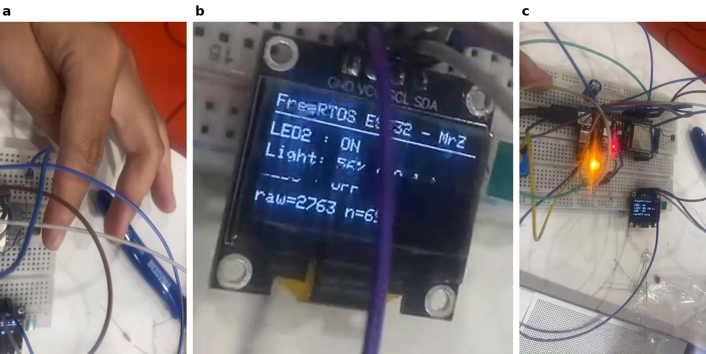
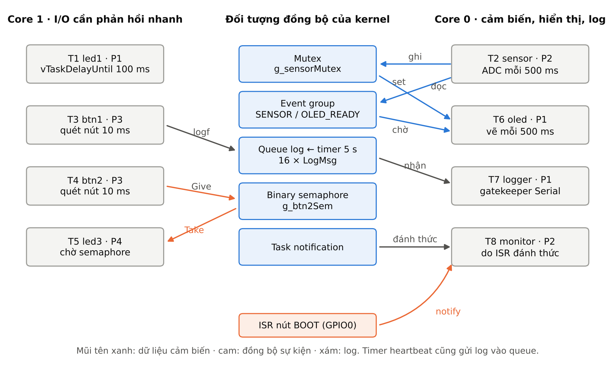
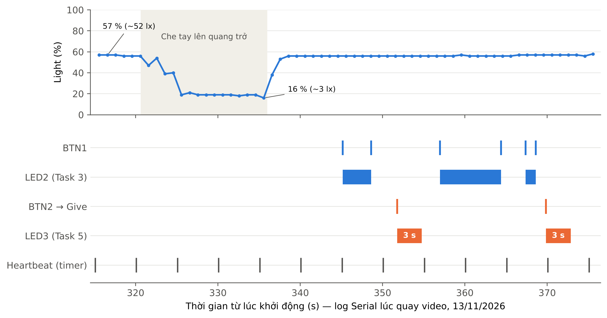

# Project cá nhân (70%) – FreeRTOS trên ESP32-S3

Sinh viên: **Lê Ngọc Hoàn** – MSSV **24119038** · GVHD: Huỳnh Hoàng Hà

8 task + 1 software timer trên ESP32-S3: LED, nút nhấn, cảm biến, OLED, đồng bộ bằng semaphore, mutex, queue, event group, task notification.

**Video chạy thử:** [`../media/demo_esp32s3.mp4`](../media/demo_esp32s3.mp4) (57 s, 13/11/2026) · **Báo cáo:** [`../03_Reports/Report_Project_CaNhan_FreeRTOS_v2.docx`](../03_Reports/Report_Project_CaNhan_FreeRTOS_v2.docx)

| Kết quả đo (log Serial) | |
|---|---|
| LED3 sáng sau mỗi lần nhấn BTN2 | 3 000 ms, 7/7 lần |
| Che tay / rọi đèn lên quang trở | 57 % → 16 % (~3 lux) / 100 % (~1 600 lux) |
| BTN2 bấm liên tiếp khi LED3 sáng | lần sau báo `da co san`, LED3 nối thêm đúng 1 lượt |
| Chu kỳ heartbeat | 5 000 ms |
| Log bị rơi sau hơn 10 phút | 0 |
| RAM / Flash | 7.1 % / 11.5 % |

## Phần cứng (mặc định ESP32-S3 DevKitC-1)
| Linh kiện | ESP32-S3 | ESP32 thường | Ghi chú |
|---|---|---|---|
| LED1 (+220 Ω) | GPIO4 | GPIO25 | Task 1, nháy T = 200 ms |
| LED2 (+220 Ω) | GPIO5 | GPIO26 | Task 3, BTN1 đảo trạng thái |
| LED3 (+220 Ω) | GPIO6 | GPIO27 | Task 5, sáng 3 s khi nhận semaphore |
| BTN1 → GND | GPIO15 | GPIO32 | INPUT_PULLUP |
| BTN2 → GND | GPIO16 | GPIO33 | INPUT_PULLUP, cấp binary semaphore |
| Nút BOOT (có sẵn) | GPIO0 | GPIO0 | ngắt → Task 8 in thông tin stack/heap |
| Quang trở + điện trở 2,2 kΩ (cầu chia: 3V3–2,2k–GPIO1–quang trở–GND) | GPIO1 | GPIO34 | ADC1, Task 2 |
| OLED SSD1306 I2C 0x3C | SDA 10, SCL 11 | SDA 21, SCL 22 | Task 6, 100 kHz, tự dò cặp chân nếu không thấy |

## Chạy
1. VS Code (đã cài extension PlatformIO + Wokwi), mở thư mục này. Thanh trạng thái dưới cùng: chọn env `esp32s3`.
2. Bấm ✓ (Build) → → (Upload) → 🔌 (Serial Monitor, 115200).
3. Kit đang cắm cổng **USB gốc** (COM4) nên `ARDUINO_USB_CDC_ON_BOOT=1`, cổng ghi cố định `upload_port/monitor_port = COM4` (máy có nhiều cổng COM ảo). Cắm cổng **UART** (CH343) thì đổi về 0 và sửa số cổng. Chip reset thì phải mở lại Serial Monitor.
4. Upload không vào được: giữ nút BOOT, nhấn RST, thả BOOT rồi Upload lại.
5. Không có phần cứng: F1 → *Wokwi: Start Simulator* (sơ đồ S3 trong `diagram.json`, sơ đồ ESP32 thường trong `docs/diagram_esp32dev.json`).
6. File nạp sẵn: `prebuilt_esp32s3/firmware.factory.bin` (nạp ở địa chỉ 0x0 bằng ESP Web Flasher / esptool nếu không muốn build).

### Ghi chú khi build trên Windows (đã gặp và đã xử lý)
- Đường dẫn có dấu ("TÀI LIỆU HỌC TẬP") làm ld báo `Invalid argument` → `platformio.ini` đặt `build_dir` ra `C:\Users\<tên>\.pio_build\rtos_personal`; `copy_fw.py` chép firmware về `.pio/wokwi/` cho Wokwi.
- PlatformIO Core 6.2.0-post.1 không nhận platform pioarduino 55.03.312 → dùng 55.03.30 (Arduino-ESP32 3.3.0).
- OLED ban đầu ở SDA=GPIO8 không chạy: GPIO8 trên kit bị kéo xuống GND (quét I2C thấy cả 126 địa chỉ trả lời) → chuyển sang GPIO10/11. `oled_init()` tự dò nhiều cặp chân, bỏ qua chân đang bị kéo về GND; mất OLED thì Task 6 in trạng thái ra Serial và tự khởi tạo lại.

**Đã build + nạp + chạy thật** trên ESP32-S3 (QFN56 rev v0.2, PSRAM 8 MB, flash 16 MB) ngày 11/11/2026: RAM 7.1%, Flash 11.5%. Ảnh minh chứng trong `docs/screenshots/`.

## Danh sách task
| Task | Tên | Core | Prio | Chu kỳ / sự kiện | Kỹ thuật |
|---|---|---|---|---|---|
| 1 | led1 | 1 | 1 | 100 ms đảo (T = 200 ms) | vTaskDelayUntil |
| 2 | sensor | 0 | 2 | 500 ms | mutex, event group |
| 3 | btn1 | 1 | 3 | quét 10 ms | chống dội, vTaskDelay |
| 4 | btn2 | 1 | 3 | quét 10 ms | xSemaphoreGive |
| 5 | led3 | 1 | 4 | chờ semaphore | xSemaphoreTake(portMAX_DELAY), critical section |
| 6 | oled | 0 | 1 | 500 ms | mutex, event group wait, đếm ngược LED3 |
| 7 | logger | 0 | 1 | chờ queue | queue, gatekeeper task cho Serial |
| 8 | monitor | 0 | 2 | ngắt nút BOOT | ISR → task notification, stack high-water mark |
| – | heartbeat | timer daemon | – | 5 s | software timer auto-reload |

Báo cáo đầy đủ: `../03_Reports/Report_Project_CaNhan_FreeRTOS_v2.docx`.

## Lỗi còn mở
Bộ đếm toàn cục `g_btn2Count` và `g_sensor.seq` đôi khi bị đặt lại về giá trị nhỏ dù chip không reset (thấy ở ~765 s và trong video). Nghi ghi tràn bộ nhớ quanh 0x3fc98960; hướng tìm: watchpoint phần cứng trên địa chỉ biến. Buổi chạy 13/11 (hơn 430 s) không gặp lại. Xem mục 6.3 của báo cáo.
