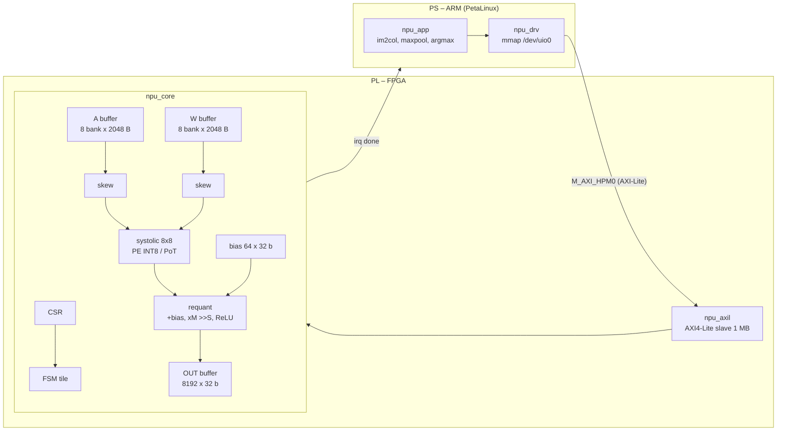
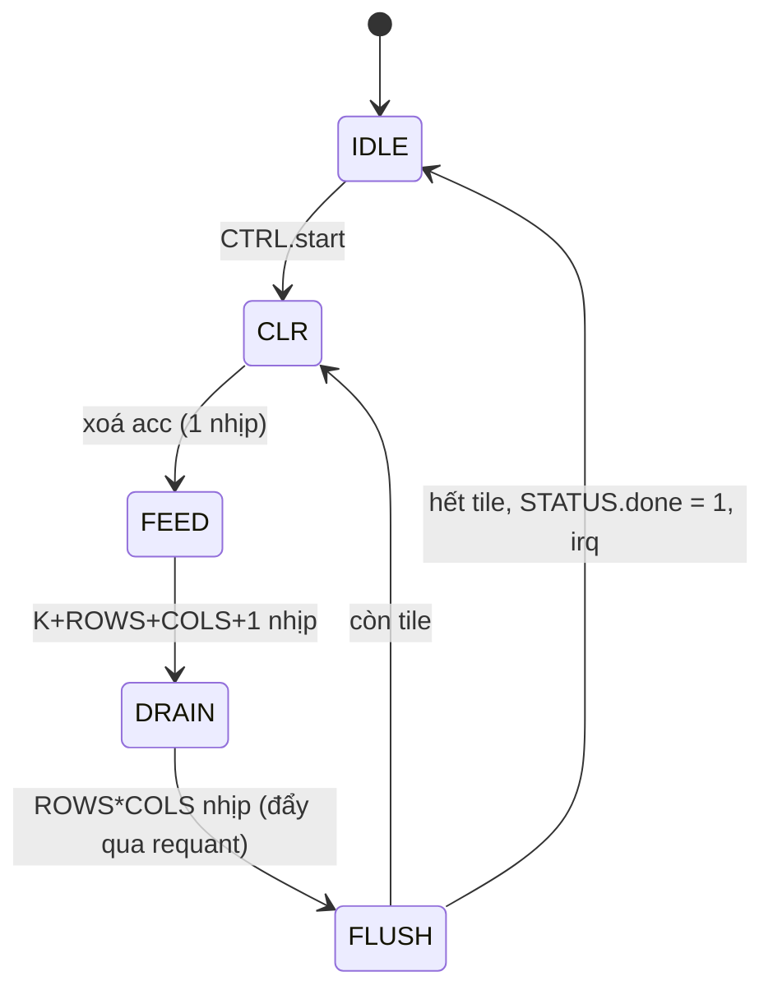

# Đặc tả kiến trúc NPU DM-SA (Dual-Mode Systolic Array)

## 1. Toàn hệ thống trên kit SoC (Zynq UltraScale+ / Zynq-7000)



Chia việc PS/PL: PL làm GEMM + bias + requant + ReLU (chiếm > 99% MAC). PS làm im2col, maxpool, chuyển HWC→CHW, argmax. Mỗi layer conv/FC là 1 lần gọi GEMM: `OUT[M×N] = requant(A[M×K] · W[K×N] + bias)`.

| Layer (MNIST 28×28) | M | K | N | Chế độ (ví dụ) |
|---|---|---|---|---|
| conv1 3×3, 1→8 | 784 | 9 | 8 | INT8 |
| conv2 3×3, 8→16 | 196 | 72 | 16 | PoT |
| fc 784→10 | 1 | 784 | 10 | INT8, raw |

## 2. Biểu diễn số

| Đại lượng | Định dạng |
|---|---|
| activation | int8 [0,127] (sau ReLU), zero-point 0 |
| weight INT8 | int8 [−127,127] |
| weight PoT | 4 bit `{s, e2 e1 e0}`: giá trị `(−1)^s · 2^e`, e = 0..6; `e = 7` là số 0 |
| accumulator | int32 |
| requant | `y = clamp((acc + bias)·M + 2^(S−1)) >>> S`, M 15 bit, S ≤ 63 |

Thuật toán trên giống hệt trong `qsim.py`, `npu_ref.h` và RTL → so sánh được từng bit.

## 3. PE (`npu_pe.v`)

```
          w_in (8b)
            │
 a_in ──►[ PE ]──► a_out (đăng ký)
            │
          w_out (đăng ký)
 prod = mode ? (e==7 ? 0 : ±(a <<< e)) : a*w      acc += prod  (khi en), acc = 0 (khi clr)
```

Tham số tĩnh `PE_MODE`: 0 dual / 1 chỉ INT8 / 2 chỉ PoT.

## 4. Dataflow output-stationary

Tile ROWS×COLS = 8×8 điểm ra. PE(i,j) giữ `acc` của `OUT[row0+i][col0+j]`.
- Hàng i nhận `A[row0+i][k]` từ bank A thứ i, trễ i nhịp (skew).
- Cột j nhận `W[k][col0+j]` từ bank W thứ j, trễ j nhịp.
- Tại PE(i,j), cặp `(A[·][k], W[k][·])` gặp nhau đúng chu kỳ `k + i + j + 2` (2 = trễ đọc buffer).
- Hàng/cột vượt M, N được mask = 0. Phần dư cuối dòng ống luôn là 0 nên không cần xoá thanh ghi PE giữa các tile.

Layout bộ nhớ (driver PS và `export_hw.py` cùng tuân theo):

```
A bank (m % 8), địa chỉ (m / 8)·K + k
W bank (n % 8), địa chỉ (n / 8)·K + k
OUT  địa chỉ m·N + n
```

## 5. FSM điều khiển



**Mô hình hiệu năng** (đã khớp đúng 100% với số chu kỳ mô phỏng):

```
cycles = ceil(M/8) · ceil(N/8) · (1 + (K + 17) + 64 + 4)
```

| Layer | Mô hình | Mô phỏng | MAC/chu kỳ (đỉnh 64) |
|---|---|---|---|
| conv1 | 98·1·95 = 9 310 | 9 310 | 6.1 |
| conv2 | 25·2·158 = 7 900 | 7 900 | 28.6 |
| fc | 1·2·870 = 1 740 | 1 740 | 4.5 |

Tổng ≈ 18 950 chu kỳ/ảnh → 0.19 ms ở 100 MHz (chưa tính thời gian nạp dữ liệu). Nút thắt: drain 64 nhịp/tile và K nhỏ ở conv1 → mục tiêu tối ưu giai đoạn 2 (double-buffer acc, drain chồng lấp, nhiều ảnh/batch cho FC).

## 6. Bản đồ thanh ghi (AXI4-Lite, 32 bit, base ví dụ `0xA000_0000`)

| Offset | Tên | Bit | Mô tả |
|---|---|---|---|
| 0x00 | CTRL | [0] | ghi 1 = start |
| 0x04 | STATUS | [0] busy, [1] done | done giữ tới lần start sau |
| 0x08/0x0C/0x10 | M / N / K | [15:0] | kích thước GEMM |
| 0x14 | CFG | [0] mode, [1] relu, [2] raw | mode 0 INT8, 1 PoT; raw = xuất acc int32 |
| 0x18 | MULT | [15:0] | hệ số requant |
| 0x1C | SHIFT | [5:0] | dịch requant |
| 0x20 | CYCLES | [31:0] | số chu kỳ lần chạy gần nhất |
| 0x24 | HWINFO | | `{0xA1, PE_MODE, 0, ROWS, COLS}` |
| 0x01000 + 4n | BIAS[n] | int32 | n < 64 |
| 0x40000 + 4(b·2048 + a) | A | [7:0] | chỉ ghi |
| 0x80000 + 4(b·2048 + a) | W | [7:0] | chỉ ghi |
| 0xC0000 + 4i | OUT[i] | int32 | chỉ đọc |

## 7. Giới hạn kích thước (tham số hoá được)

`ceil(M/8)·K ≤ 2048`, `ceil(N/8)·K ≤ 2048`, `M·N ≤ 8192`, `N ≤ 64`. Đủ cho cả 3 layer MNIST. Layer lớn hơn: driver chia M thành nhiều lần gọi.

## 8. Tài nguyên dự kiến (8×8, chưa có số Vivado)

- PE: xem `05_rtl/sim/yosys_pe_report.txt` (dual ≈ 95 LUT + 1 DSP / PE → ~6 K LUT + 64 DSP cho mảng).
- Buffer: A + W = 16 × 2 KB, OUT 32 KB, ≈ 16 BRAM36 (Ultra96-V2 có 216 BRAM36, 360 DSP).
- Mục tiêu tần số 100–150 MHz (requant đã chia 2 tầng pipeline; mux chọn acc 64:1 là đường dài nhất cần theo dõi).
