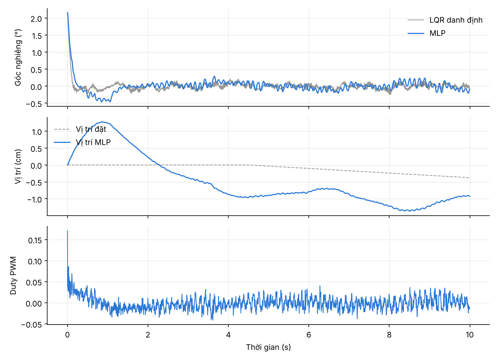

# Xe cân bằng ESP32-S3 chạy model AI (FreeRTOS + MLP)

Sinh viên: **Lê Ngọc Hoàn** – MSSV **24119038**

Mạng nơ-ron nhỏ (MLP, 4 129 tham số) giữ thăng bằng xe 2 bánh, chạy trực tiếp trên ESP32-S3 trong một task FreeRTOS 200 Hz. Model được huấn luyện trên Google Colab bằng mô phỏng vật lý, rồi xuất ra file `.h` để nạp vào firmware.

> **Trạng thái:** model và firmware đã chạy được trong mô phỏng, phần C khớp Python. Chưa chạy trên xe thật vì chưa có mạch. Chân cắm trong `firmware/include/config.h` là tạm, sẽ sửa theo mạch.

```
04_BalanceBot_ESP32S3/
├── colab/
│   ├── BalanceBot_ESP32S3_Colab.ipynb   mở bằng Colab → Runtime → Run all (~5 phút, CPU là đủ)
│   └── model_out/                       kết quả lần chạy gần nhất (model, file .h, biểu đồ)
└── firmware/                            project PlatformIO cho ESP32-S3
    ├── include/config.h                 chân cắm, chiều IMU/động cơ/encoder
    ├── include/balance_policy.h         trọng số MLP (sinh từ notebook)
    ├── include/lqr_gains.h              bộ LQR dự phòng (sinh từ notebook)
    ├── src/main.cpp                     3 task FreeRTOS: điều khiển, in trạng thái, nhận lệnh
    ├── src/policy.c                     chạy MLP bằng C thuần, không cần thư viện
    └── host_test/test_policy.c          kiểm tra C trên PC: khớp Python sai lệch 1,9e-7
```

## Model học như thế nào

1. **Mô phỏng** xe 2 bánh (con lắc ngược trên bánh) gồm động cơ DC có sức phản điện động, vùng chết PWM, encoder lượng tử, IMU có nhiễu và lệch, trễ 1 chu kỳ, bị đẩy tay ngẫu nhiên.
2. **Mỗi xe mô phỏng có thông số khác nhau:** khối lượng ±25 %, chiều cao trọng tâm ±30 %, mô-men động cơ ±30 %, pin 10,5–12,6 V, vùng chết 2–12 %.
3. **Teacher** là LQR biết thông số thật và trạng thái thật của từng xe. Ngoài đời không có bộ điều khiển như vậy.
4. **Student (MLP)** chỉ thấy những gì ESP32 đo được: 8 mẫu cảm biến gần nhất và 3 lệnh PWM trước. Nhờ lịch sử này, nó tự nhận ra xe nặng hay nhẹ, động cơ mạnh hay yếu.
5. **DAgger:** student tự lái, teacher sửa ở từng bước; lặp 6 vòng, tổng 1,3 triệu mẫu.

**Kết quả trên 300 xe mô phỏng mới** (cùng điều kiện cho mọi bộ điều khiển):

| Bộ điều khiển | Xe không ngã | RMS góc nghiêng | RMS sai lệch vị trí |
|---|---|---|---|
| Teacher (giới hạn trên, không có ngoài đời) | 100 % | 0,48° | 6,0 cm |
| LQR danh định (cách làm thường) | 100 % | 0,72° | 22,2 cm |
| **MLP float trên ESP32** | **100 %** | **0,51°** | **9,4 cm** |
| MLP int8 (TFLite Micro, 9,3 KB) | 100 % | 0,55° | 8,3 cm |

Đây là số liệu mô phỏng. Ngoài đời, kết quả phụ thuộc mô hình có sát xe thật không. Vì vậy cần đo lại thông số và có thể tinh chỉnh model bằng dữ liệu ghi từ xe (mục 8 của notebook).



## Phần cứng cần có

### Để huấn luyện model
- Tài khoản Google để dùng Colab: CPU miễn phí là đủ, không cần GPU vì model rất nhỏ.
- Laptop có VS Code + PlatformIO và cáp USB-C để nạp ESP32-S3.
- Không cần board AI riêng: ESP32-S3 có FPU và lệnh vector, chạy MLP này mỗi 5 ms vẫn dư thời gian. Firmware in thời gian chạy thật (`nn=… us`).

### Để làm xe
| Linh kiện | Gợi ý | Ghi chú |
|---|---|---|
| Vi điều khiển | ESP32-S3 DevKitC-1 N16R8 | đã có |
| Cảm biến góc (IMU) | MPU6050 (GY-521) | rẻ, đủ dùng; muốn ít trôi hơn thì dùng ICM-42688-P hoặc BMI088 |
| 2 động cơ | GA25-370 12 V, 280–400 rpm, **có encoder Hall** | encoder là bắt buộc: model cần tốc độ và vị trí bánh |
| Bánh xe | 65 mm, lỗ trục 4 mm + khớp nối | |
| Driver động cơ | TB6612FNG | 1,2 A liên tục, 3,2 A đỉnh mỗi kênh, đủ cho GA25; động cơ lớn hơn (JGB37-520) thì dùng 2 × DRV8871 |
| Pin | 3S Li-ion 18650 (11,1 V) + mạch BMS 3S + đế pin, hoặc LiPo 3S 1300–2200 mAh | |
| Hạ áp | Buck MP1584 hoặc LM2596 → 5 V / 3 A | cấp vào chân 5V của kit; IMU và encoder lấy 3,3 V từ kit |
| Bảo vệ | Công tắc, cầu chì 3–5 A, tụ 470 µF/25 V sát driver | |
| Đo pin | Điện trở 100 kΩ + 33 kΩ chia áp vào GPIO9 | firmware tắt động cơ khi pin < 10 V |
| Khung | 2–3 tầng mica hoặc in 3D, ốc M3, dây XH2.54/Dupont | IMU gắn chắc, gần trục bánh, không bị rung |

## Chạy trên xe (khi có mạch)

1. **Sửa chân cắm** trong `firmware/include/config.h` theo mạch thật.
2. **Build và nạp:** mở thư mục `firmware` bằng VS Code + PlatformIO. Serial Monitor chạy ở 921600 baud. Khi khởi động, firmware tự kiểm tra MLP so với Python.
3. **Kiểm tra chiều, khi động cơ còn tắt:**
   - Nghiêng xe tới trước thì `theta` phải dương; nếu sai, đổi `IMU_FWD_SIGN` / `IMU_GYRO_SIGN`.
   - Lăn xe tới trước thì `phi_dot` phải dương; nếu sai, đổi `ENC_L_SIGN` / `ENC_R_SIGN`.
4. **Chạy LQR trước** (lệnh `l`), tay đỡ xe. Nếu bánh chạy ngược chiều ngã, đổi `MOTOR_L_SIGN` / `MOTOR_R_SIGN`.
5. **Đo thông số thật**, gồm khối lượng thân, chiều cao trọng tâm, bánh, động cơ. Sửa mục 1 của notebook → **Run all**. Chép `balance_policy.h`, `balance_policy_test.h`, `lqr_gains.h` vào `firmware/include/` rồi nạp lại.
6. **Chạy MLP** bằng lệnh `n`.
7. **Lái:** `w`/`s` tiến lùi, `a`/`d` rẽ, `x` dừng, `o` tắt.
8. **Tinh chỉnh bằng dữ liệu thật (tuỳ chọn):**
   - Chạy LQR, gõ `g` để bật log, lái 2–3 phút rồi lưu các dòng `L,...` thành `real_log.csv`.
   - Tải file lên Colab, chạy mục 8 rồi chạy lại mục 6–7.

Xe ngã quá 34° hoặc pin yếu thì động cơ tự tắt. Bật lại chỉ được khi xe đã được dựng gần thẳng (< 5°).

## Kiến trúc FreeRTOS

| Task | Core | Priority | Chu kỳ | Việc làm |
|---|---|---|---|---|
| ctrl | 1 | 5 | 5 ms (`vTaskDelayUntil`) | đọc IMU → lọc bù → đọc encoder (PCNT phần cứng) → MLP/LQR → PWM 20 kHz |
| tele | 0 | 1 | queue / 200 ms | in trạng thái, in log dữ liệu, kiểm tra pin |
| cmd | 0 | 2 | 20 ms | nhận lệnh từ Serial |

Dữ liệu giữa các task: critical section cho trạng thái, queue cho log, mutex cho cổng Serial.
